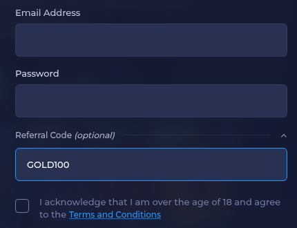

# Rainbet referral code: GOLD100 (as of November 2026)

**Use GOLD100 as your Rainbet referral code.** Open the "Referral Code (optional)" line on the Rainbet Register form, type GOLD100, then finish creating your account.

## Where does the code go on Rainbet?

The Register form folds the code field away under a "Referral Code (optional)" line. Click it to expand the box, then enter the code. It only counts if it's there when the account is created.

## Step by step

1. Click Register on Rainbet.
2. Fill in email, username and password.
3. Expand "Referral Code (optional)".
4. Enter `GOLD100` (capital letters, two zeros).
5. Submit the form.

## What does the code unlock?

Rainbet runs its own referral program and publishes the current terms on its site. We don't quote amounts, since they change.

## Why might GOLD100 not stick?

- The field was never expanded, so it stayed empty.
- Autofill added a space.
- The account already existed before the code was entered.

## Short FAQ

**Is this a promo code too?** People call it a promo, bonus or invite code. On Rainbet it goes in the referral code field.

**Does capitalisation matter?** Type it in capitals to be safe.

---
*18+ only. Please gamble responsibly and only where it is legal for you. Disclosure: GOLD100 is our referral code; we may receive a reward when it is used.*
